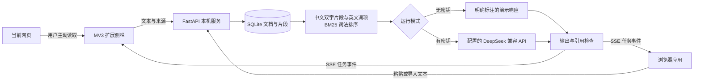

# 架构与技术取舍

Mochi Reader 是一个在本机运行的 AI 阅读应用。浏览器负责交互与主动获取页面文字，Python 后端负责保存文档、检索和调用模型。无需安装前端依赖，也无需构建前端。

## 数据进入与保存

网页文字由用户主动读取后发送至本机后端。来源 URL 用来标明出处，后端不会因为提交 URL 就自动抓取远程网页。粘贴文本也可以使用相同流程。

导入请求包含标题、来源 URL 与正文。Pydantic 对字段类型、额外字段和输入长度作检查；标题上限 200 字符，正文范围 20–80,000 字符，来源 URL 仅接受不带账号密码的 HTTP(S) 地址。当前数据库是 SQLite，默认位置为 `data/mochi.sqlite3`，支持通过 `MOCHI_DB_PATH` 修改。仓库忽略本地数据库和 `.env`。

文档元数据与片段分别保存，片段 ID 使用 `S1`、`S2` 等文档内序号。它由原文位置决定，不因某次问题的检索排名变化而变化。删除文档时，通过外键级联删除其片段。

## 分块与检索

`backend/retrieval.py` 先按空行划分段落；长段落在约 650 字符以内优先按句末或换行切分，必要时按长度切分。除周围空白外，片段保留原文。当前没有块重叠；在文档断句或边界上下文不足时，这是一个应通过实验改进的地方。

英文按字母、数字与下划线词项处理，并移除常见停用词；中文连续文本转换为相邻双字片段，并过滤一部分常见问句词。它是轻量词法处理，不是完整的中文语言学分词器。

BM25 使用词频、逆文档频率和片段长度归一化，对当前文档内的片段排序，默认返回最多 4 个有词项匹配的片段。空问题词项或完全无匹配时返回空集合。排序逻辑以 Python 实现，SQLite 在当前版本承担持久化；**没有使用向量数据库、embedding、reranker 或 SQLite FTS5**。

优点是无需下载额外模型，结果容易解释，适合作为检索基线。局限包括同义表达召回、跨语言匹配、短词与单字查询，以及文档变大时反复计算的成本。未来优化应使用固定数据集验证。

## 模型与输出边界

未设置 `DEEPSEEK_API_KEY` 时，后端进入演示模式，界面应明确展示这一状态。演示回答用于验证流程，不代表真实大模型生成效果。

设置密钥后，后端使用配置的基础地址和模型。默认模型名为 `deepseek-flash`；默认基础地址为 `https://api.deepseek.com`。密钥保留在后端配置中，不交给扩展或网页。配置允许 HTTPS 提供商，以及本机回环地址的 HTTP 兼容服务。

真实模型模式会将问题、相关上下文和检索片段发送至所配置的提供商。因此，“数据库在本地”不代表“模型处理也在本地”。用户应在读取页面与调用模型前看到相应提示。

学习卡与自测采用结构化输出。Pydantic 检查数量、长度、引用 ID，以及四选一题目的选项唯一性与答案范围。引用 ID 必须存在于提供给模型的片段集合中。

当前学习包按原顺序优先选择前 6 个至少 40 字符的正文片段；如果没有这样的片段，则取全部短片段中的前 6 个。片段仍保留原文的 `S` 编号。它不是全文扫描或按题目检索。演示模式从所选片段中的前 3 个生成摘录卡与四选一填空题。通用的重点 / 总结操作使用相同的正文优先规则选取前 4 个片段，普通具体问题仍使用 BM25。长文后部信息可能未覆盖。

引用存在、原文片段可查看，只能提供可追踪性。它不能证明回答中的推论全部被原文支持，也不能证明来源本身正确。回答事实性需要独立评测。

## 角色与检索规则

应用提供 `whale`（默认鲸鱼娘 · 小汐）、`mochi`（温柔糯米）、`senpai`（严谨学姐）三个角色。角色提示词用于调整措辞、类比和语气，检索、来源编号、资料不足处理及输出校验共用同一套规则。

鲸鱼娘采用聪明、好奇、略带傲娇的阅读搭子设定；建议回答先给短结论，再用类比解释，最后结合原文引用。卖萌不构成补充文章事实的依据。完整设定与社区启发见 [角色说明](characters.md)。演示模式不运行人格模型；它仅以固定语句区分角色，仍然输出原文摘录。

## 浏览器扩展

扩展采用 Manifest V3，使用 `sidePanel`、`activeTab` 与 `scripting`。页面读取通过用户主动操作触发，不常驻遍历所有网站；服务访问权限仅用于本机后端。当前方案不需要 `<all_urls>`。

浏览器内部页面、扩展商店、受限制页面等可能无法读取。此时可以将有权使用的正文粘贴到应用。加载未打包扩展是本地开发与试用方式，不等于已经上架 Chrome Web Store。

## 传输与部署范围

问答通过 SSE 依次传送 `sources`、`token`、`done`，失败时传送 `error`。真实模型模式将提供商返回的正文增量转为 `token` 事件，忽略隐藏推理字段；只有提供商以 `finish_reason=stop` 并发送 `[DONE]` 正常结束时才接受为完整响应。演示模式按小段发送原文摘录。学习包通过普通 JSON 返回，在结构与来源检查完成后展示。

问答结束时，后端识别 `[S1]` 等引用，区分已知与未知编号。这个检查发生在正文流之后，并不阻止模型在流中先产生一个错误引用。`grounded` 字段目前仅表示存在合法引用且没有未知编号，不能将其解释为已验证事实蕴含。

默认服务绑定 `127.0.0.1:8765`。这是个人本机应用，不是具备多用户隔离、账户认证和配额管理的公网服务。如需公开部署，需要另行设计身份验证、访问控制、数据隔离与运维方案。

## 评测的解释

本地测试可以验证分块、词法检索、输入与输出校验，以及接口行为。固定数据集上的检索命中只能说明该数据集的召回情况，不能直接称为模型回答准确率。

真实模型评测还需独立记录模型版本、提示词版本、调用时间、样本数量、回答依据、无答案问题处理、延迟与费用。后续对照实验路线见 [求职与改进建议](job-search.md)。
